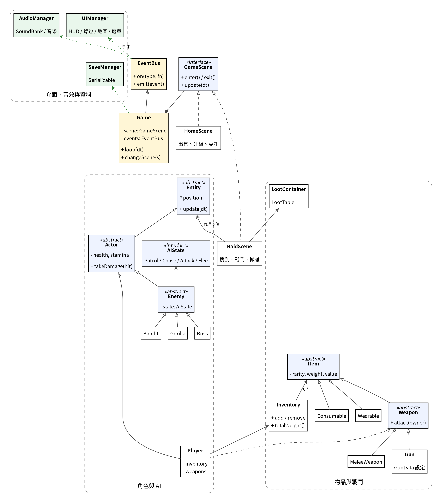

# AOOP 第 1 組期末專題提案補充說明

## 專題名稱與組員

AOOP_Final_Project_Group_1：Monkey Businessman

第 1 組：劉育麟 112511002、張倖嘉 112511004、譚羽良 112511017。

公開 Repo：https://github.com/MoobyMoo/AOOP_Final_Project_Group_1/

正式提案請使用 [PDF](AOOP_Final_Project_Proposal_第1組.pdf) 或 [可編輯 Word](AOOP_Final_Project_Proposal_第1組.docx)。建置計畫簡報：[AOOP_Group1_Build_Plan.pptx](AOOP_Group1_Build_Plan.pptx)。

## 專題動機與目標

一款俯視角的卡通撤離射擊遊戲。玩家是一隻破產、穿西裝的猴子商人，從海灘碉堡出發，進入叢林搜刮香蕉、零件和寶物，對付搶匪與野生動物，並自己決定什麼時候撤離：走得越深收穫越多，但被打倒就會失去背包裡沒保住的東西。帶回家的戰利品可以出售、升級裝備、完成委託。

目標是完成一個可在瀏覽器遊玩的完整循環：出發、搜刮、戰鬥、撤離、回家升級。這類遊戲有許多種敵人、武器、物品與場景，適合用類別階層、介面與多型組織，也容易分給三位組員各自負責一個模組。

技術採用 TypeScript 與 Three.js，以 Vite 建置，在瀏覽器執行。

## 核心功能與範圍

- 角色與戰鬥：移動、滑鼠瞄準、閃避翻滾、體力；公事包近戰與多種槍械；命中、爆頭與護甲計算。
- 敵人 AI：搶匪、猩猩、Boss 各有不同行為，以狀態（巡邏、追擊、攻擊、逃跑）切換。
- 搜刮與背包：搜索容器、物品稀有度、背包與安全口袋、負重、撤離點與倒地懲罰。
- 基地與進度：出售戰利品、工作台升級、委託任務、存檔與讀檔。
- 介面與選單：主選單、暫停選單、HUD、背包與戰利品介面、地圖。
- 音效系統：槍聲、腳步、受擊、介面音效與背景音樂，依遊戲事件播放。

## 系統架構與物件導向設計

- **封裝**：Actor 管理自己的血量、體力與受傷規則，外部只呼叫 `takeDamage(hit)`；Inventory 管理格子與重量。
- **繼承與多型**：Entity → Actor → Player／Enemy → Bandit、Gorilla、Boss；Item → Weapon、Consumable、Wearable。RaidScene 對所有實體呼叫 `update(dt)`；`Weapon.attack()` 由近戰武器與槍各自實作。
- **介面**：GameScene、AIState、Serializable 定義共同契約，新增場景、敵人行為或可存檔物件只要實作介面。
- **設計模式**：敵人 AI 用狀態模式；EventBus 用觀察者模式，UIManager 與 AudioManager 訂閱遊戲事件，三個模組不直接相依。
- **資料驅動**：槍械、物品與掉落表寫成設定資料（GunData、LootTable），新增內容不需改類別。存檔與結算有單元測試，自動試玩機器人檢查遊戲能完整跑完。

類別圖原始檔：[assets/proposal-architecture.dot](assets/proposal-architecture.dot)（Graphviz）。

## 成員分工

| 組員 | 負責工作 |
| --- | --- |
| 張倖嘉 Michelle／112511004 | 介面模組（UIManager 與 UI 面板）：主選單、暫停選單、HUD、背包與戰利品介面、地圖 |
| 劉育麟 Jasper／112511002 | 音效模組（AudioManager、SoundBank）：SFX 整理與命名、事件對應、背景音樂、音量設定 |
| 譚羽良／112511017 | 遊戲核心：類別階層、戰鬥與武器、敵人 AI、搜刮與存檔、系統整合與程式審查 |

三人各自用自己的 GitHub 帳號在分支提交，以 Pull Request 合併。

## 繳交

提案截止時間為 2026 年 11 月 16 日 23:59，由組長繳交。繳交檔名為 `AOOP_Final_Project_Proposal_第1組.pdf`，並附公開 Repo 連結。

## 依據

- 課程公告與官方 Word 範本，保留於 `templates/`。
- [組員資料來源](team.md)。
